# type-clipboard

クリップボードの文字を、選んだ窓へキー入力として 1 文字ずつ打ち込む Windows のアプリ。

貼り付け (Ctrl+V) が効かない画面に、長いパスワードなどを入れるために使う。

- Hyper-V の仮想マシン接続 (VMConnect) の拡張セッションのサインイン画面
- リモートデスクトップ (RDP) のサインイン画面
- ブラウザで開く VNC のコンソール (仮想化基盤やクラウドの管理画面)

単一の exe で、インストールは要らない。

## 入手

- [Releases](https://github.com/pollenjp/type-clipboard/releases) から `type-clipboard.exe` を落とす。
  `type-clipboard.exe.sha256` に SHA-256 を置いてある。
- 出る前の版を試すなら、Actions の CI の実行 (PR か main) の成果物 (Artifacts) の `type-clipboard` を落とし、
  zip の中の `type-clipboard.exe` を使う。

### SmartScreen の警告

exe に署名していないので、初めて起こすと「Windows によって PC が保護されました」と出ることがある。
「詳細情報」を押すと出る「実行」で起こせる。

## 使い方

図は画面の動きを描いたもの (窓の名前は例)。

1. `type-clipboard.exe` を起こす。

   

2. 打つ先の窓を選ぶ。
   - 一覧で選ぶ。一覧をなぞると、その窓が「候補」としてプレビューに映り、画面の上でもその窓に橙の枠が付く。

     

   - 「クリックで選ぶ」を押してから、打つ先の窓をクリックする。マウスで指した窓が候補として映る。
     そのクリックは相手の窓には届かない。Esc か右クリックでやめる。

     

   - 選んだ窓は「打つ先」として、動いたままプレビューに映り続ける。
3. 打つ先でパスワードの欄を出し、欄をクリックしておく。
4. パスワード管理アプリなどで値をコピーする。このアプリには文字数だけが出る。

   

5. 「クリップボードを打つ」を押す。打つ先が前に出て、0.5 秒ほど置いてから 1 文字ずつ打つ。進み具合だけが出る。

   

6. 打ち終わったら、打つ先で Enter を押す。このアプリは Enter を押さない。

   

### 止まるとき

打っている最中に次のことがあれば、そこで止める。何文字打ったところで止めたかと、止めたわけを出す。

- ほかの窓が前に来た
- 手でキーを押した (Esc を含む)。押したキーは打つ先に届けない
- ほかのアプリがキーを送った。押す方は打つ先に届けない。このアプリが送ったキーを打つ先のアプリが打ち直した写しと、
  文字を打たない仮想キー 0xFF では止めない (下の「キーを打ち直すアプリ」)
- どこかをクリックした



### 打たずに断るとき

- 打つ先が管理者として動いている (下の「管理者として動く窓」)
- 途中に改行かタブがある (Enter や Tab を押すことになるため。末尾の改行は落として打つ)
- 打てない文字がある (選んだ配列に無い文字・全角・絵文字など。どの文字かは出さず、数だけを出す)
- Shift・Ctrl・Alt・Win が押されたまま
- CapsLock がオン (「キーの位置」の打ち方のとき。大文字と小文字が逆になるため)
- 打つ先で手元の IME がオン (IME が文字を変換し、違う値が黙って入るため)

## 2 つの打ち方

| 打ち方 | 送るもの | 向く先 |
| --- | --- | --- |
| キーの位置 (VNC・RDP 向け。既定) | 文字を、選んだ配列でのキーの位置 (scancode) と Shift に直して送る | RDP・VMConnect・VNC。押したキーの位置が相手へ送られ、相手の OS が自分の配列で文字に直す |
| 文字 (Unicode) | 文字そのもの | 手元のふつうのアプリ |

「文字 (Unicode)」でも、VMConnect の拡張セッションに試し打ちの見本と日本語の文字が入ることは確かめた (確かめたのはこの 2 つだけ)。

1 文字ごとの間隔は既定で 30 ms。相手が取りこぼすなら長くする。

## 配列の選び方 (「キーの位置」の打ち方)

「打つ先の配列」は、相手 (VM や接続先) の OS のキーボードの配列に合わせる。初めて起こしたときは、英語 (US) が
選ばれている (手元の Windows の配列にはよらない)。選んだ配列は、閉じるときに設定に残り、次に起こしたときもそれが選ばれる。

- RDP・VMConnect: 接続先の OS の配列。
- VNC: サーバーがキーの位置を受け取るか、文字 (keysym) しか受け取らないかで、合う配列が変わる。
  - キーの位置を受け取るもの (noVNC と QEMU の拡張キーイベントなど): 相手の OS の配列。
  - 文字 (keysym) しか受け取らないもの: ブラウザが手元の配列で文字に直して送るので、手元の Windows の配列。
  - どちらか分からなければ、試し打ちで確かめる。合わなければ配列か打ち方を切り替える。

## 試し打ち

「試し打ち」は、決まった見本 (英字の大文字と小文字・数字・ASCII の記号の一通り) を打つ先へ打つ。

```text
ABCXYZ abcxyz 0123456789 !"#$%&'()*+,-./:;<=>?@[\]^_`{|}~
```

打った文字が見えるテキストの欄 (ユーザー名の欄・VM の中のメモ帳・コンソールのログインの入力など) に打ち、
見本と同じになるかを目で確かめる。記号が違えば、配列か打ち方が合っていない。パスワードの欄は伏せ字で見えないので向かない。

## 管理者として動く窓

Windows は、管理者として動く窓へ、管理者でないアプリからの入力を届けない (UIPI)。打つ先が管理者として動いていると、
打つ前に断る。そのときは、このアプリも「管理者として実行」で起こせば打てる。

## クリップボードの中身の扱い

パスワードなどを打つための道具なので、中身の写しをこのアプリの外に残さないようにしている。

- 中身は画面・ログ・ファイル・設定に出さない。文字数だけを出す。
- このアプリのコードは中身を写さない。文字数を数えるときも、打つときも、Windows が渡す中身を、クリップボードを開いている
  間に読む (Windows がこのアプリのメモリに置く写しは、下の「防げないもの」)。
- 打つときに作る打つ列 (打つ文字を、送るキーに直したもの) は、専用のメモリに置き、ページファイルに書き出させない
  (VirtualLock)。1 文字ずつ送るときに使う stack と、写しと照らすために覚える直前のキー (下の「キーを打ち直すアプリ」) も
  同じく留める。打ち終えたら (止めたときも) 上書きしてから手放す。
  - 留められないとき (長すぎる文字など) は、打たずに断る。パスワードの長さなら起きない。
  - 画面の thread の stack を留められないときは、起動しない。
- クラッシュしたときに Windows のエラー報告 (WER) が取る dump に、heap と打つ列のメモリを入れない。この設定はこのアプリの
  中だけで、Windows の設定 (レジストリ) は変えない。
- 打つ処理が異常終了しても、キー入力を止める hook を外して、その旨を出す。panic のときは写しも消す。
- 外へ書き出す書き方 (標準出力・標準エラー・`dbg!`・ファイル・デバッガ・イベントログ・レジストリ・プロセスを起こす・
  ネットワーク・ログの crate のマクロ) を足すと、CI の clippy で止まる。依存の crate の中で書き出すものと、`clippy.toml` に
  挙げていない API は止まらない。

このアプリでは防げないもの:

- 打つ先の側: 受け取った文字の扱い (リモートの先の OS やアプリ)・途中の経路・ほかのアプリのキーボードの hook。
- クリップボードそのもの: Windows が持つ中身・クリップボードの履歴 (Win+V)・ほかの端末との同期・クリップボードを読むほかのアプリ。
  打ち終えたら、パスワード管理アプリの機能などでクリップボードを消す。履歴や同期を使っていれば、そちらにも残る。
  - このアプリが読むたびに (クリップボードが変わって文字数を数え直すたびにも)、Windows がこのアプリのメモリに中身の写しを
    置く。この写しは、このアプリでは留めることも上書きすることもできず、ページファイルに書き出されうる。
- 休止状態 (ハイバネーション) のファイルと、メモリ全体を書き出すもの (システムのクラッシュの完全なダンプなど):
  メモリの中身がそのまま書き出される (留めたメモリも含む)。
- WER の dump に入る stack と register: 打っている最中にクラッシュすると、そのとき送っていた 1 文字ぶんの値が入りうる。
  管理者が設定した dump の取り方 (WER の LocalDumps など) も、このアプリでは決められない。
- 同じユーザーで動くほかのプロセス・管理者・デバッガ: このアプリのメモリを読める。
- CPU の register と OS の側 (kernel) に一時的に乗る、1 文字ぶんの値。

## キーボードとマウスの hook

「クリックで選ぶ」の間と打っている間だけ、低レベルのキーボードとマウスの hook を入れる。クリックを相手の窓に届けないためと、
利用者の入力で打つのを止めるため。入力の中身は記録しない。それ以外のときは入れない。打つ処理が異常終了しても外す。

### キーを打ち直すアプリ (VMConnect など)

Hyper-V の仮想マシン接続 (VMConnect) の拡張セッションは、前にいる間、自分の低レベルのキーボードの hook で、届いた修飾キー
(少なくとも Shift と Ctrl) をいったん止め、印を付け替えて打ち直す。文字のキーは打ち直さない。この hook は前に来たときに入り、
その約 0.5 秒後に入れ直されることがある。そのたびに、文字を打たない合成のキー (仮想キー 0xFF) も流れる。このアプリはそれでも
打てるよう、打っている間の hook を 2 つの段で使い分ける。

- 待つ段 (打つ先を前に出してから、打ち始めるまでの 0.5 秒ほど): 手で押したキーとクリックで止める。ほかのアプリが送ったキーは通す。
- 打つ段 (打ち始めてから、打ち終えるまで): 1 文字を送る前に毎回 hook を入れ直す。Windows は後から入れた hook を先に呼ぶので、
  打つ先が hook を入れ直しても、送るときにはこのアプリの hook が打つ先の hook より先にキーを見る。このアプリが送ったキーと、
  その直後に来る写し (同じキーで、印だけが違うもの) だけを通す (照らすために、このアプリが送った直前のキーを、打っている
  間だけ専用のメモリに覚える)。ほかのキーの押下 (手で押したもの・ほかのアプリが送ったもの) とクリックで止める。
- どちらの段でも、ほかのアプリが送った仮想キー 0xFF は通す (文字を打たないので、通しても打つ値は変わらない)。

写しを変えて返すアプリや、遅れて返すアプリでは止まる (違う値を黙って打つより、止まる方を選んでいる)。待つ段では打つ先の hook が
先にキーを見るので、打つ先が打ち直す修飾キーを手で押しても、見落とすことがある (打ち始める前に、修飾キーが押されたままで
ないかは確かめる)。

## 設定

打ち方・配列・間隔・常に手前・窓の位置を、閉じるときに `%APPDATA%\type-clipboard\settings.ini` に残す。
打つ先とクリップボードの中身は残さない。

## ビルド

CI (GitHub Actions の windows-latest) で fmt の確認・clippy・test・release ビルドを流し、exe を成果物に上げる。

手元 (Linux・WSL) では、nix flake の devShell で作れる。Rust の版は `rust-toolchain.toml` (CI と同じ)。

```sh
nix develop
cargo test                                                    # OS に触らない部分の test (Linux でも動く)
cargo clippy --target x86_64-pc-windows-msvc -- -D warnings   # Win32 の部分の型検査
cargo xwin build --release --target x86_64-pc-windows-msvc    # exe を作る
```

- exe は `target/x86_64-pc-windows-msvc/release/type-clipboard.exe` にできる。
- `cargo xwin` は初回に Microsoft の CRT と Windows SDK を取ってくる (1 GB ほど。Microsoft のライセンスに同意したことになる)。

Windows で直に作るなら、rustup と Visual Studio の Build Tools (C++ のツール) を入れて `cargo build --release`。

「使い方」の図 (`docs/images/usage-*.svg`) は `docs/images/make_usage_svgs.py` で作る。文言や配置を直すときは
SVG ではなく script を直し、devShell の中で `python3 docs/images/make_usage_svgs.py` を流して作り直す。

## Release の出し方

`Cargo.toml` の version を上げて main に入れた後、`v0.1.0` のような tag を push する。workflow が exe と SHA-256 を作り、
GitHub Release に置く。

版を書く所は `Cargo.toml` だけ。exe に埋め込む manifest の版 (`app.manifest` の `assemblyIdentity`) は、build.rs が
`Cargo.toml` の版から入れる。

## ライセンス

[MIT](LICENSE)
